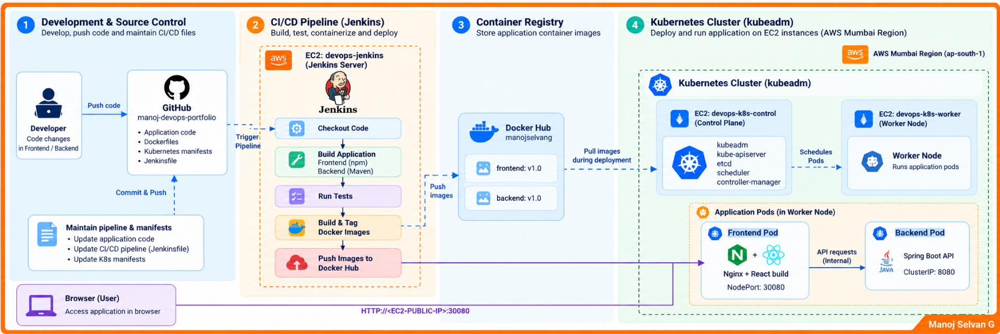
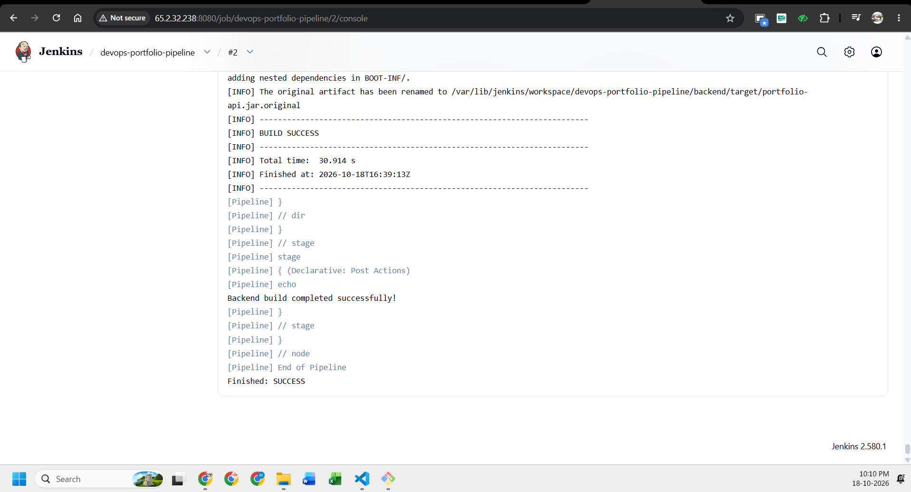
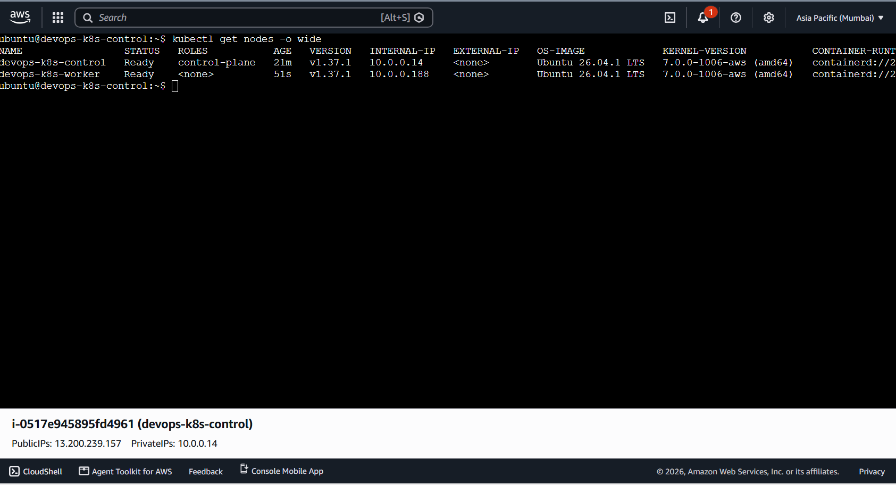
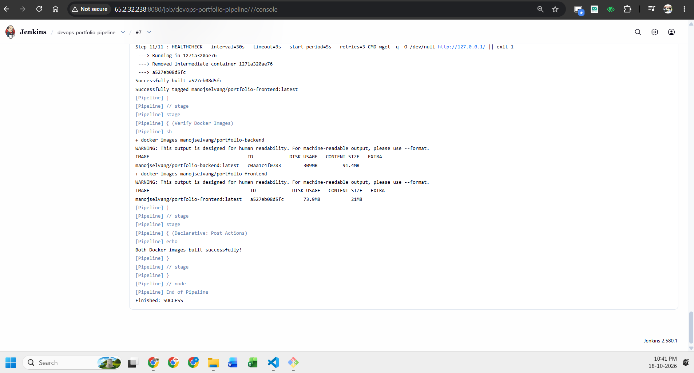
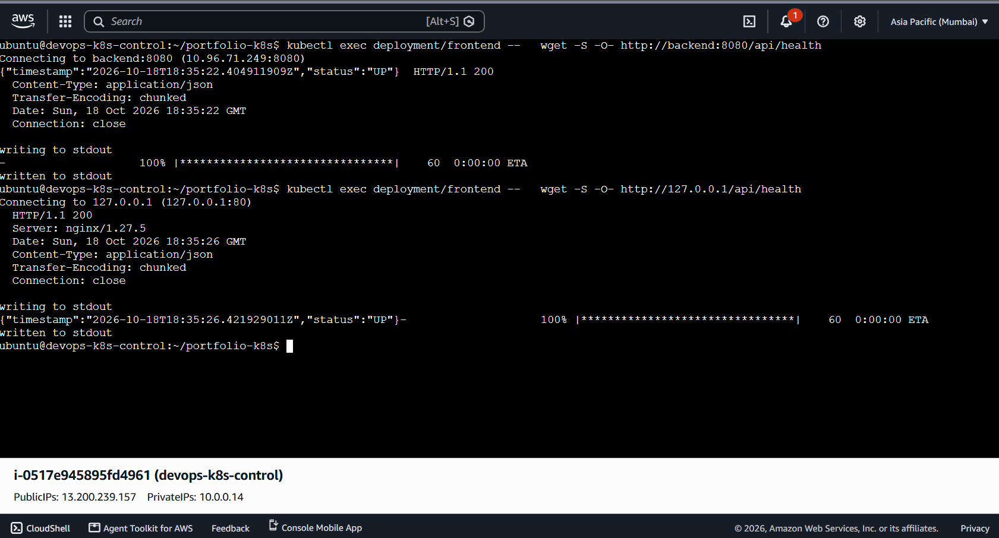
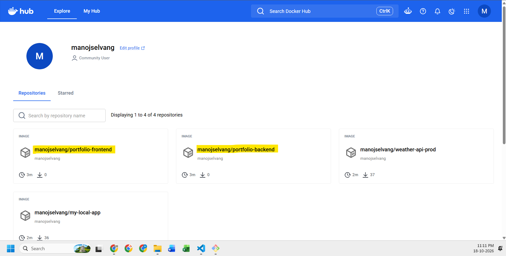
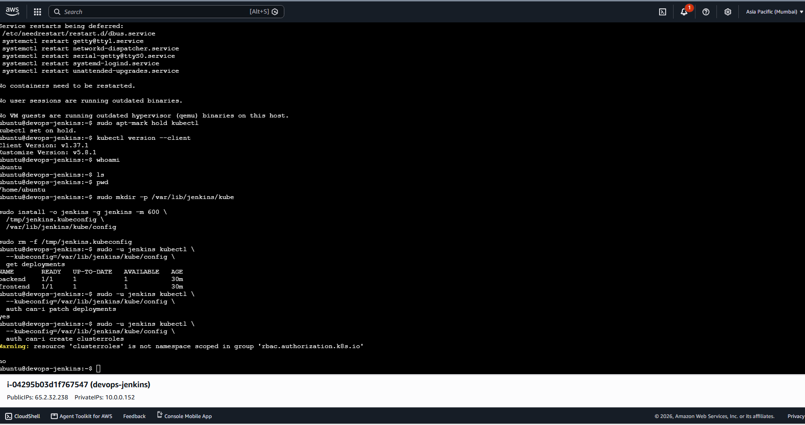

# DevOps Portfolio – CI/CD with Jenkins, Docker, and Kubernetes

A hands-on DevOps portfolio project that automates building, containerizing, publishing, and deploying a React + Spring Boot application using Jenkins, Docker Hub, and Kubernetes on AWS EC2.



> **Architecture diagram:** Keep `architecture-diagram.png` in the root of this repository, alongside this `README.md`.

## Project at a Glance

- **Source control:** GitHub
- **CI/CD:** Jenkins Pipeline
- **Frontend:** React, Vite, Nginx
- **Backend:** Java, Spring Boot, Maven
- **Containerization:** Docker
- **Image registry:** Docker Hub
- **Orchestration:** Kubernetes with `kubeadm`
- **Infrastructure:** AWS EC2, Ubuntu 24.04
- **Pod networking:** Calico

## Repositories

- **Application source:** https://github.com/manojselvang/manoj-devops-portfolio
- **CI/CD repository:** `manoj-devops-portfolio-cicd` — update this with the repository URL after it is created and pushed.

The application repository contains the frontend and backend source code. This repository contains the Jenkinsfile, Kubernetes manifests, helper scripts, Screenshots, and documentation.

## End-to-End Workflow

1. Jenkins checks out the application source from GitHub.
2. Maven builds and packages the Spring Boot backend.
3. Docker builds frontend and backend images.
4. Jenkins pushes the images to Docker Hub using a Jenkins credential.
5. Jenkins validates the Kubernetes manifests.
6. Jenkins deploys the newly built image versions to Kubernetes.
7. Jenkins waits for rollout completion and verifies the application resources.



## Architecture and Infrastructure

The lab uses three AWS EC2 instances in the Mumbai region (`ap-south-1`).

| Instance | Role | Private IP |
|---|---|---|
| `devops-jenkins` | Jenkins and pipeline execution | `10.0.0.152` |
| `devops-k8s-control` | Kubernetes control plane | `10.0.0.14` |
| `devops-k8s-worker` | Kubernetes worker node | `10.0.0.188` |

Kubernetes was initialized using `kubeadm`, with Calico providing pod networking. The control-plane and worker nodes reached the `Ready` state.



### Network access

| Service | Port | Guidance |
|---|---:|---|
| SSH | `22` | Restrict to trusted source IPs |
| Jenkins UI | `8080` | Restrict to trusted source IPs |
| Frontend NodePort | `30080` | Restrict to trusted source IPs |
| Kubernetes API | `6443` | Keep private; allow only authorized systems |

Do not expose the Kubernetes API or administrative interfaces to the public internet.

## Application Components

### Frontend

- React and Vite application served by Nginx in a Docker container.
- Kubernetes Service uses NodePort `30080`.
- Nginx serves the frontend and proxies `/api/` requests to the backend Service.

### Backend

- Java and Spring Boot application.
- Built with Maven; the packaged artifact is `backend/target/portfolio-api.jar`.
- Exposed internally by a Kubernetes ClusterIP Service on port `8080`.
- Health endpoint: `/api/health`.



The frontend Nginx proxy and backend health endpoint were tested together:



## Docker Hub Images

The pipeline publishes these images:

- `manojselvang/portfolio-backend`
- `manojselvang/portfolio-frontend`

Use a build-specific image tag for each pipeline run and deploy that exact tag. Avoid relying exclusively on `latest` when you need reproducible releases.



## Kubernetes Deployment

The main Kubernetes resources are:

- `Deployment/backend`
- `Service/backend` — ClusterIP
- `Deployment/frontend`
- `Service/frontend` — NodePort `30080`
- `ServiceAccount/portfolio-deployer`
- A namespace-scoped `Role` and `RoleBinding` for Jenkins deployment access

Jenkins should use a restricted deployment identity, not cluster-admin permissions.

Useful commands:

```bash
# Cluster nodes
kubectl get nodes -o wide

# Application resources
kubectl get deployments,services
kubectl get pods -o wide

# Deployment rollout status
kubectl rollout status deployment/backend --timeout=180s
kubectl rollout status deployment/frontend --timeout=180s

# Recent cluster events
kubectl get events --sort-by=.metadata.creationTimestamp
```

### RBAC verification

The Jenkins deployment identity should have only the permissions needed to update and verify the application. It should not be able to create cluster roles.

```bash
kubectl auth can-i patch deployments
kubectl auth can-i get pods
kubectl auth can-i create clusterroles
```



## Repository Structure

```text
manoj-devops-portfolio-cicd/
├── Jenkinsfile
├── README.md
├── architecture.md
├── architecture-diagram.png
├── .gitignore
├── k8s/
│   ├── backend.yaml
│   └── frontend.yaml
├── scripts/
│   ├── validate-manifests.sh
│   └── verify-deployment.sh
└── Screenshots/
```

Keep the frontend Service manifest synchronized with the live cluster configuration. If the intended public access method is NodePort, specify `type: NodePort` and `nodePort: 30080` in `k8s/frontend.yaml`.

## Prerequisites

- GitHub repository containing the application source.
- Jenkins with Git, Java, Maven, and Docker available to the Jenkins service user.
- Docker Hub account and push permissions.
- A working Kubernetes cluster and a restricted credential for Jenkins.
- Kubernetes manifests matching the image names, tags, Services, and ports.
- AWS security-group rules that allow required traffic while limiting administrative access.

## Running the Pipeline

1. Confirm Jenkins can clone the application and CI/CD repositories.
2. Store Docker Hub credentials in Jenkins Credentials. If the Jenkinsfile references it, use credential ID `dockerhub-credentials`.
3. Configure Kubernetes access using a Jenkins Secret file credential where possible. Never commit kubeconfig files to Git.
4. Configure the Jenkins Pipeline job to use the repository's `Jenkinsfile`.
5. Run the pipeline and inspect the Console Output.
6. Confirm the expected image tags are available in Docker Hub.
7. Verify Kubernetes rollout status and inspect the Pods and Services.
8. Open the application using the permitted worker-node address and port `30080`.

Credential IDs and job settings must match the actual Jenkins configuration.

## Troubleshooting Commands

```bash
# Check nodes and Pods
kubectl get nodes -o wide
kubectl get pods -o wide

# Inspect application Deployments
kubectl describe deployment backend
kubectl describe deployment frontend

# Review application logs
kubectl logs deployment/backend
kubectl logs deployment/frontend

# Inspect recent events
kubectl get events --sort-by=.metadata.creationTimestamp
```

If a Pod is not ready, inspect its events and logs before changing the configuration. If Jenkins cannot run Docker, verify that Docker is running and that the Jenkins service user has the required permissions.

## Security Practices

- Do not commit `.pem` files, private keys, tokens, kubeconfig files, passwords, or `.env` files.
- Store Docker Hub credentials in Jenkins Credentials, never in the Jenkinsfile.
- Restrict access to Jenkins UI, SSH, and NodePort `30080` to trusted IP addresses.
- Keep Kubernetes API port `6443` private.
- Use least-privilege Kubernetes RBAC for Jenkins.
- Prefer immutable, build-specific image tags and deploy the exact versions built by the pipeline.
- Rotate any credential that may have been exposed.


## Architecture Documentation

See [architecture.md](architecture.md) for the detailed architecture, network flow, infrastructure notes, and design decisions.

## Author

**Manoj Selvan G**

- GitHub: https://github.com/manojselvang
- LinkedIn: https://www.linkedin.com/in/manojselvang/

---

This is a learning portfolio project demonstrating practical DevOps workflows. Review security, availability, and operational requirements before adapting the setup for production use.
